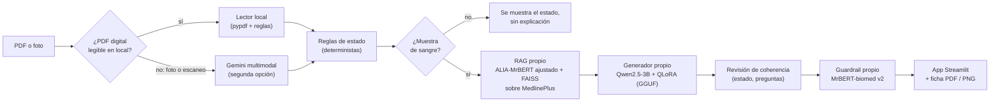
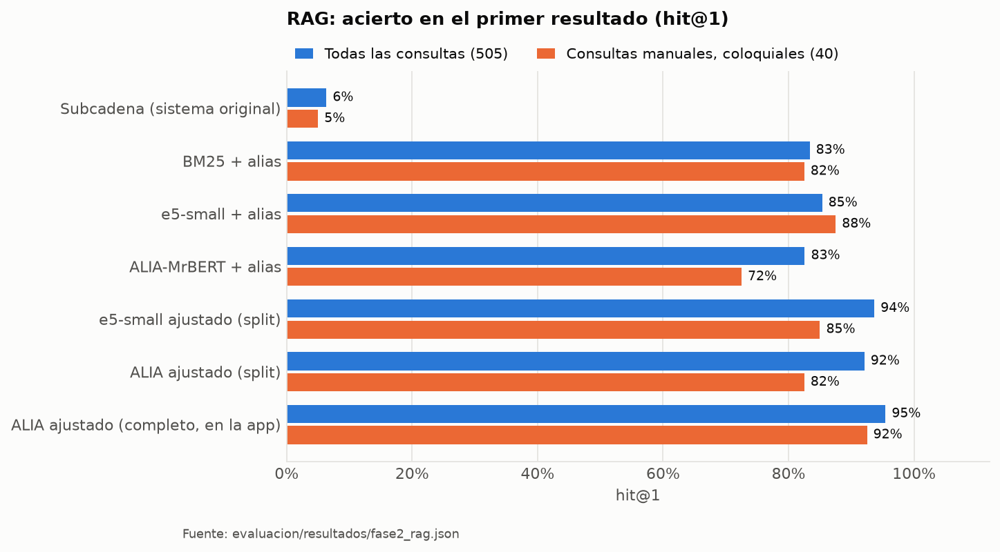
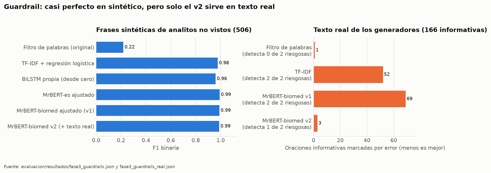
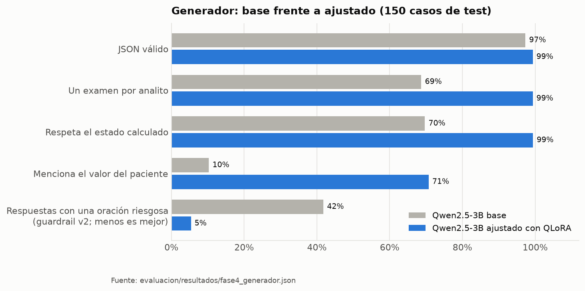
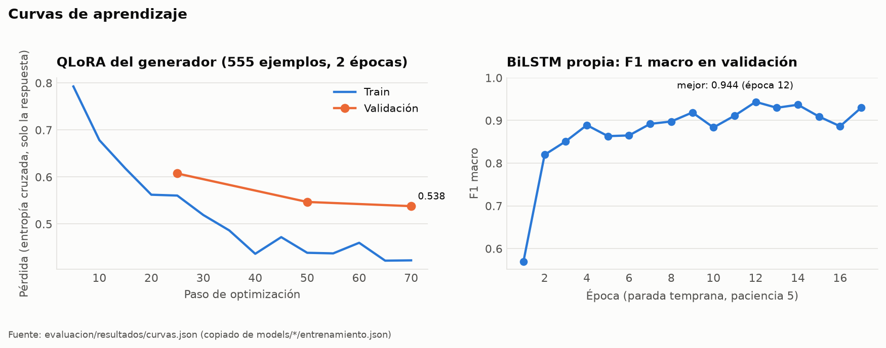
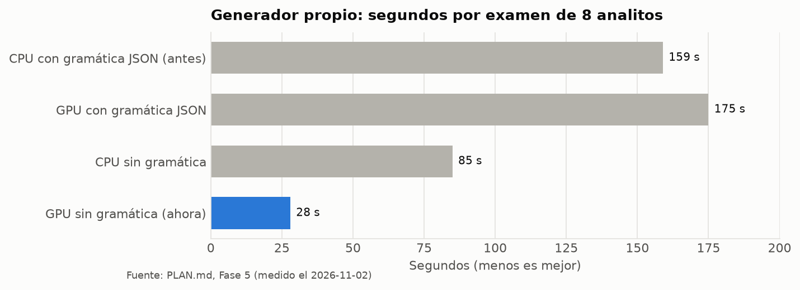

# 🩺 LetraDeMédico

> **Traductor de resultados de exámenes de sangre a lenguaje claro, con modelos entrenados por el equipo.**


Las consultas médicas suelen ser cortas y los resultados de laboratorio llegan llenos de siglas, unidades y rangos. **LetraDeMédico** lee el informe (PDF o foto), calcula si cada valor está alto, bajo o normal, lo explica en español claro y prepara preguntas para llevar a la consulta.

⚠️ **No diagnostica ni reemplaza al médico.** Su trabajo es informar y preparar al paciente para la consulta.

**Alcance: solo exámenes de sangre** (hemograma, química sanguínea, perfil lipídico, perfil hepático, tiroides, electrolitos). Si un documento trae resultados de orina u otras muestras, la app los muestra con su estado, pero no los explica.

---

## ✨ Qué hace

- **Lee el documento** y extrae cada examen con su valor, unidad y rango de referencia, además del sexo y la edad del paciente si aparecen. No extrae el nombre ni otros datos personales.
  - Un **PDF digital** del laboratorio se lee **en local**, sin Gemini ni internet (`lector_pdf.py`).
  - Una **foto o un PDF escaneado** se lee con Gemini, que es la segunda opción.
- **Calcula el estado con reglas deterministas** (ALTO, BAJO, NORMAL o ANORMAL). Entiende rangos como "70 a 99", "Menor a 200" o "Hasta 40", y también rangos por sexo ("Hombres: … Mujeres: …") y por categorías ("Normal: < 5.7 Prediabetes: …").
- **Explica cada resultado** con un generador propio (Qwen2.5-3B ajustado con QLoRA), apoyado en fragmentos de **MedlinePlus en español** que recupera un RAG propio.
- **Revisa cada oración** con un clasificador propio (MrBERT-biomed) que marca frases diagnósticas o alarmistas.
- **Corrige sus propios errores:**
  - reemplaza una explicación que contradiga el estado calculado;
  - quita las preguntas que digan "alto" de un valor normal, que nombren un examen que el paciente no se hizo o que se repitan.
- **Genera una ficha para la consulta** en **PDF** (para imprimir, con casillas y espacio para notas), **imagen PNG** (para el celular) o texto.
- **Responde dudas** con el fragmento de MedlinePlus que corresponde y su fuente.

## 🏗️ Arquitectura



La app tiene dos motores:

- **Modelos propios** (`MODO=propio`): **el motor principal y el que se usa por defecto.** RAG, generador y guardrail entrenados por el equipo, que corren en local.
- **Gemini** (`MODO=gemini`): **segunda opción.** Es el sistema original y se conserva como línea base de comparación y como respaldo si faltan los modelos propios.

Con el motor principal, **un PDF digital se procesa entero sin Gemini**: lectura, reglas, explicación, revisión, guardrail y respuestas a dudas. Gemini solo entra para leer fotos o PDFs escaneados, que no tienen capa de texto. También entra si la lectura local no es confiable, o si el usuario pulsa "Leerlo otra vez con Gemini" porque algún valor no coincide. `LDM_LECTURA=local` o `LDM_LECTURA=gemini` fuerzan una de las dos lecturas.

| Componente | Modelo | Entrenamiento | Código |
|---|---|---|---|
| Estado del analito | Reglas | No aplica: se mide y se corrige | `backend.py` (`evaluar_con_rango`) |
| RAG | `SINAI/ALIA-MrBERT-es-biomedical-embeddings` + FAISS | Ajuste contrastivo con negativos difíciles | `training/rag/` |
| Guardrail | `BSC-LT/MrBERT-biomed` | Fine-tuning de clasificación en 3 clases | `training/guardrails/` |
| Generador | `Qwen2.5-3B-Instruct` | QLoRA (4 bits, r = 16), exportado a GGUF Q4_K_M | `training/generador/` |

## 📊 Resultados

Todos los números salen de `evaluacion/resultados/*.json`. Las figuras se regeneran con `python informe/figuras.py`.

| | Sistema original | **Modelos propios** |
|---|---|---|
| Regla de estados: formatos del dataset sintético (10.604 analitos) | 83,4 % | **100 %** |
| Regla de estados: formatos reales de sangre sondeados (33) | 22 / 33 | **33 / 33** |
| RAG: acierto en el primer resultado, consultas coloquiales (40) | 5,0 % | **92,5 %** |
| RAG: acierto en analitos que el modelo nunca vio (`split`) | 0,0 % | **91,2 %** |
| Guardrail: F1 binaria en frases de analitos no vistos | 0,219 | **0,991** |
| Guardrail: falsos positivos en texto real (166 informativas) | 1 (pero no detecta ninguna riesgosa) | **3** (v2) |
| Generador: respeta el estado calculado (150 casos) | 69,7 % (Qwen base) | **99,4 %** |
| Generador: respuestas con alguna oración riesgosa | 41,8 % (Qwen base) | **5,4 %** |
| Tiempo por examen de 8 analitos | — | **28 s** en GPU, 85 s en CPU |







El detalle de cada experimento, sus decisiones y hallazgos está en [`PLAN.md`](PLAN.md). El vínculo con la teoría del curso (perceptrón, funciones de pérdida, descenso del gradiente, retropropagación, sobreajuste) está en [`informe/fundamentos.md`](informe/fundamentos.md).

---

## 🚀 Instalación y uso

Probado con Python 3.11 en Windows 11.

### 1. Dependencias

```bash
# Solo la app con el motor Gemini
pip install -r requirements.txt

# Modelos propios en CPU (llama-cpp-python desde ruedas precompiladas, sin compilar)
pip install -r requirements-propio.txt --extra-index-url https://abetlen.github.io/llama-cpp-python/whl/cpu

# Opcional: generador en una GPU NVIDIA (unas 3 veces más rápido que en CPU)
pip install -r requirements-gpu.txt --force-reinstall --no-deps --extra-index-url https://abetlen.github.io/llama-cpp-python/whl/cu124
```

La app detecta sola si hay GPU; si no la hay, sigue en CPU. `LDM_GPU_CAPAS=0` obliga a usar la CPU.

### 2. Clave de Gemini

Crea un archivo `.env` en la raíz:

```env
GEMINI_API_KEY=tu_clave_api_aqui
```

### 3. Modelos propios

Los pesos no se versionan, por tamaño. Van en `models/`:

```
models/rag/alia-ajustado-completo/          # embeddings del RAG
models/rag/indice-alia-ajustado/            # índice FAISS (se construye solo la primera vez)
models/guardrails/mrbert-biomed-v2/         # clasificador del guardrail
models/generador/letrademedico-qwen2.5-3b-v2-q4_k_m.gguf   # generador v2 (por defecto)
models/generador/letrademedico-qwen2.5-3b-q4_k_m.gguf      # generador v1 (respaldo si falta el v2)
```

Si falta alguno, la app ofrece solo el motor Gemini y dice cuál falta. Cómo entrenarlos (con notebooks para Colab T4) está en `PLAN.md`.

### 4. Ejecutar

```bash
streamlit run app.py
```

Abre `http://localhost:8501`. La pestaña de ejemplos interactivos funciona sin subir archivos.

### 5. Pruebas

```bash
python -m pytest tests -q      # esperado: 159 passed (sin modelos ni Gemini)
```

## 📁 Estructura

```
app.py, ui_components.py     # interfaz Streamlit
backend.py                   # pipeline: extracción, reglas, RAG, generador, revisión y guardrail
modelos_propios.py           # carga y uso de los tres modelos del equipo
ficha_consulta.py            # ficha para la consulta en PDF e imagen
training/                    # datos sintéticos, RAG, guardrails y generador (scripts y notebooks de Colab)
evaluacion/                  # scripts de métricas y resultados en JSON
informe/                     # fundamentos teóricos y figuras
tests/                       # pruebas con pytest
```

## ⚠️ Limitaciones

- **No es un dispositivo médico.** Las explicaciones son informativas y la app siempre remite al médico.
- **Las fotos y los PDF escaneados dependen de Gemini**, una API externa con cuotas, y una foto borrosa puede extraerse mal.
- **El lector local reconoce diseños por bloques y por tabla.** Se midió con 2 PDFs reales de laboratorios distintos (Compensar 2021 y Colsanitas 2011) y 450 PDFs sintéticos en 3 diseños, todos leídos al 100 %. Si el texto del PDF viene en desorden, las filas se rearman por la posición de cada fragmento. Un diseño muy distinto puede leerse mal sin que el lector lo note: por eso la app avisa que el documento se leyó en local y ofrece releerlo con Gemini.
- **Solo sangre y solo los analitos de la base.** El RAG cubre 41 analitos con páginas de MedlinePlus. Un examen que no está (por ejemplo, IGF-1) se explica sin guía y la app lo avisa.
- **Los rangos de entrenamiento son de adultos.** La app usa siempre el rango que trae el laboratorio, pero el generador se entrenó con casos de 18 a 85 años.
- **El generador todavía se equivoca a veces:**
  - inventa el significado de algunas siglas ("VCM = Volumen de Célula Móvil");
  - sugiere causas algo especulativas;
  - repite preguntas o dice "alto" de un valor normal.

  La revisión de coherencia y el guardrail atrapan una parte; el resto queda para la revisión humana.
- **Las etiquetas del guardrail en texto real vienen de un LLM juez**, no de humanos, y el test real tiene solo 2 frases riesgosas. Su cifra de detección es indicativa.

---

## 👨‍💻 Autor

- **Rubiano Valero** - Idea original y desarrollo.
