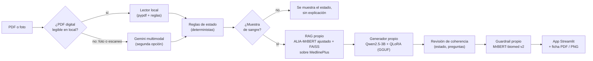
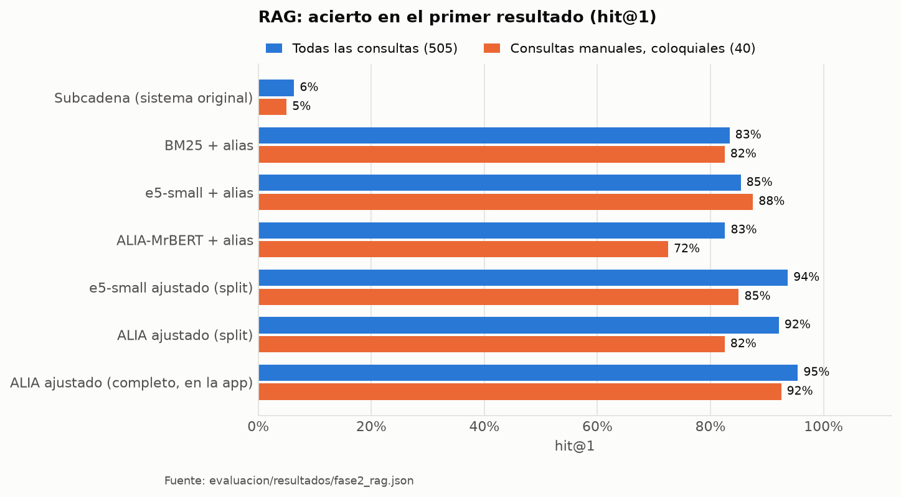
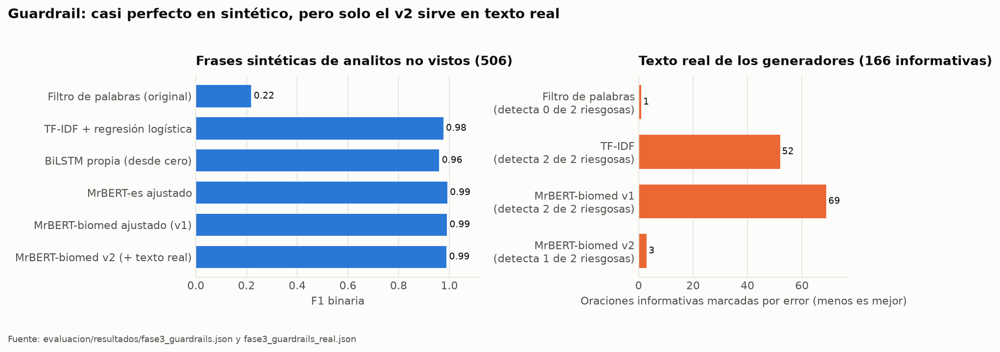
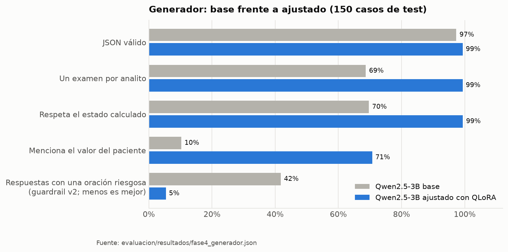
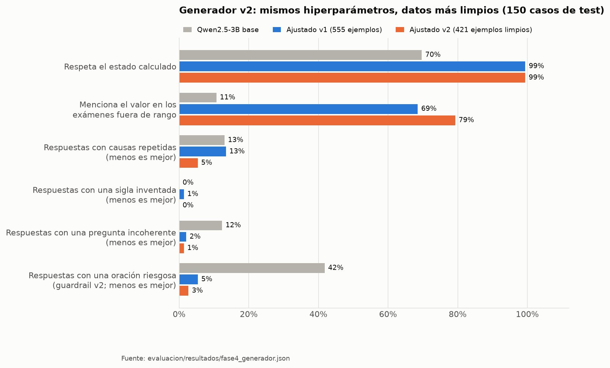
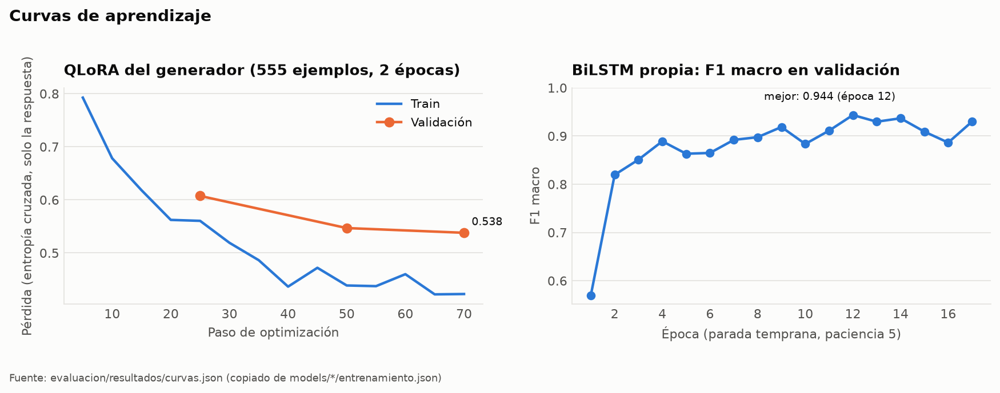
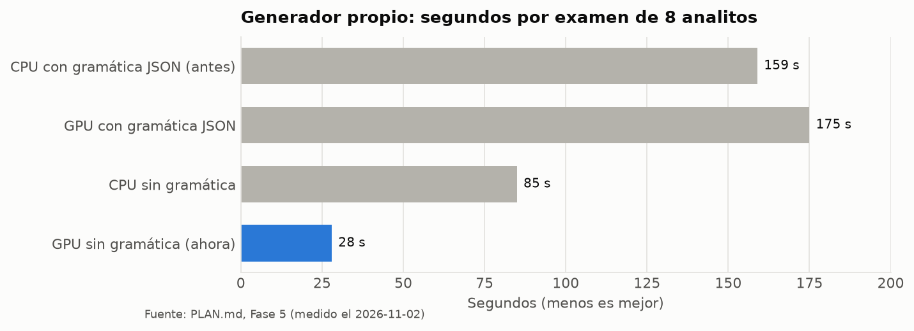

# 🩺 LetraDeMédico

**Traducción de resultados de exámenes de sangre a lenguaje claro mediante modelos neuronales entrenados por el equipo**


> ⚠️ **Aviso.** LetraDeMédico es un proyecto académico. **No diagnostica ni reemplaza al médico**: su propósito es informar al paciente y prepararlo para la consulta.

---

## Tabla de contenido

1. [Resumen](#1-resumen)
2. [Planteamiento del problema](#2-planteamiento-del-problema)
3. [Objetivos](#3-objetivos)
4. [Alcance](#4-alcance)
5. [Arquitectura del sistema](#5-arquitectura-del-sistema)
6. [Metodología](#6-metodología)
7. [Resultados](#7-resultados)
8. [Fundamentos teóricos](#8-fundamentos-teóricos)
9. [Reproducibilidad](#9-reproducibilidad)
10. [Estructura del repositorio](#10-estructura-del-repositorio)
11. [Limitaciones y consideraciones éticas](#11-limitaciones-y-consideraciones-éticas)
12. [Trabajo futuro](#12-trabajo-futuro)
13. [Autoría y referencias](#13-autoría-y-referencias)

---

## 1. Resumen

Los resultados de laboratorio llegan al paciente cargados de siglas, unidades y rangos de referencia, y la consulta médica rara vez deja tiempo para explicarlos. **LetraDeMédico** recibe un informe de laboratorio (PDF o fotografía), extrae cada analito con su valor y rango, determina con reglas deterministas si está **alto, bajo o normal**, lo explica en español claro y propone preguntas para llevar a la consulta.

El sistema original dependía por completo de una API externa (Gemini). Este trabajo lo sustituye por **tres modelos neuronales propios**, entrenados y evaluados por el equipo:

| Componente | Modelo base | Técnica de entrenamiento |
|---|---|---|
| **Recuperador (RAG)** | `SINAI/ALIA-MrBERT-es-biomedical-embeddings` + FAISS | Ajuste contrastivo con negativos difíciles |
| **Guardrail** | `BSC-LT/MrBERT-biomed` | *Fine-tuning* de clasificación en 3 clases |
| **Generador** | `Qwen2.5-3B-Instruct` | QLoRA (4 bits, r = 16) con destilación desde modelos profesores; exportado a GGUF Q4_K_M |

**Hallazgos principales.** Frente al sistema original, el RAG propio pasa de 5,0 % a **92,5 %** de acierto en el primer resultado con consultas coloquiales; el guardrail pasa de una F1 de 0,219 a **0,989** en analitos no vistos; y el generador ajustado respeta el estado calculado en el **99,4 %** de los casos (69,7 % el modelo base), con solo un **2,7 %** de respuestas que contienen alguna oración riesgosa (41,8 % el modelo base). Un PDF digital se procesa **de principio a fin en local**, sin servicios externos.

## 2. Planteamiento del problema

- Los informes de laboratorio están escritos para profesionales: el paciente ve un número y un rango, pero no sabe qué significa ni qué preguntar.
- Los modelos de lenguaje generales **alucinan, contradicen el dato o usan un tono diagnóstico y alarmista**, lo que es inaceptable en un contexto de salud.
- Depender de una API comercial implica enviar datos de salud a terceros, cuotas de uso y resultados no reproducibles.

La pregunta que guía el proyecto es: **¿pueden modelos pequeños, entrenados por el equipo y ejecutados en local, explicar resultados de laboratorio con mayor fidelidad y seguridad que un sistema basado en un LLM comercial?**

## 3. Objetivos

**Objetivo general.** Construir y evaluar un sistema que explique resultados de exámenes de sangre en lenguaje claro y seguro, con modelos neuronales propios que funcionen en local.

**Objetivos específicos.**

1. Generar un **dataset sintético** de exámenes de laboratorio para medir y corregir la lógica de clasificación de estados.
2. Entrenar un **recuperador semántico** sobre MedlinePlus en español que entienda consultas coloquiales.
3. Entrenar un **clasificador de seguridad** (guardrail) que detecte oraciones diagnósticas o alarmistas.
4. Ajustar con **QLoRA** un generador pequeño que explique cada resultado de forma coherente con el estado calculado.
5. **Integrar** los tres modelos en una aplicación usable y **evaluarla** con PDFs reales de laboratorio.
6. Vincular cada decisión de entrenamiento con los **principios de redes neuronales** vistos en el curso.

## 4. Alcance

- **Incluye:** exámenes de sangre (hemograma, química sanguínea, perfil lipídico, perfil hepático, tiroides, electrolitos). La base de conocimiento cubre **41 analitos** con páginas de MedlinePlus en español.
- **Excluye:** orina y otras muestras (la app muestra su estado, pero no las explica), diagnóstico, recomendaciones de tratamiento y población pediátrica (el generador se entrenó con casos de 18 a 85 años).
- **Privacidad:** el lector extrae sexo y edad si aparecen, pero **no** el nombre ni otros datos personales.

## 5. Arquitectura del sistema



**Flujo.**

1. **Lectura.** Un PDF digital se lee en local (`lector_pdf.py`), reconociendo diseños por bloques y por tabla. Solo las fotos y los PDF escaneados recurren a Gemini.
2. **Estado del analito.** Reglas deterministas (`backend.py`, `evaluar_con_rango`) que interpretan rangos como "70 a 99", "Menor a 200", "Hasta 40", rangos por sexo y por categorías clínicas.
3. **Recuperación.** El RAG busca el fragmento de MedlinePlus que corresponde al analito **y a su estado** (alto o bajo).
4. **Generación.** El generador redacta la explicación y las preguntas a partir del dato y del pasaje recuperado.
5. **Autocorrección.** Se reemplazan explicaciones que contradicen el estado y se eliminan preguntas incoherentes, repetidas o sobre exámenes que el paciente no se hizo.
6. **Guardrail.** Cada oración se clasifica; las diagnósticas o alarmistas se marcan.
7. **Salida.** Interfaz Streamlit y una **ficha para la consulta** en PDF (imprimible), PNG (para el celular) o texto.

**Motores.** `MODO=propio` (por defecto) usa los modelos del equipo; `MODO=gemini` conserva el sistema original como **línea base de comparación** y respaldo.

## 6. Metodología

El proyecto se desarrolló en fases incrementales; cada una tiene su script de evaluación y un archivo de resultados en `evaluacion/resultados/`. El detalle completo (decisiones, experimentos descartados y bitácora) está en [`PLAN.md`](PLAN.md).

| Fase | Contenido | Código | Resultados |
|---|---|---|---|
| **0. Preparación** | Entorno, estructura y línea base | — | — |
| **1. Datos sintéticos** | Generador de exámenes (`--n 2000 --seed 42`, 10.604 analitos) para medir y corregir las reglas de estado | `training/sintetico/` | `fase1_reglas.json` |
| **2. RAG** | Base de conocimiento de MedlinePlus, comparación de recuperadores y ajuste contrastivo con negativos difíciles; *split* por analito para medir generalización | `training/rag/` | `fase2_rag.json` |
| **3. Guardrail** | Frases sintéticas etiquetadas, red propia como referencia y *fine-tuning* de MrBERT-biomed; validación en texto real etiquetado por un LLM juez | `training/guardrails/` | `fase3_guardrails*.json` |
| **4. Generador** | Casos del dataset sintético → respuestas de modelos profesores → filtrado por verificación automática → QLoRA sobre Qwen2.5-3B → GGUF | `training/generador/` | `fase4_generador.json`, `curvas.json` |
| **5. Integración** | Lector local de PDF, RAG según el estado del analito, autocorrección y pruebas con PDFs reales | `app.py`, `backend.py`, `lector_pdf.py` | `fase5_*.json` |
| **6. Informe** | Vínculo con la teoría del curso y figuras | `informe/` | `informe/figuras/` |

### 6.1 Datos

| Conjunto | Origen | Ubicación |
|---|---|---|
| Exámenes sintéticos | Generador propio con catálogo de analitos y semilla fija | `data/sintetico/` (se regenera) |
| Base de conocimiento | MedlinePlus en español | `data/rag/documentos.jsonl` |
| Consultas de entrenamiento del RAG | Generadas por LLM a partir de cada fragmento | `data/rag/consultas_entrenamiento.jsonl` |
| Frases del guardrail | Sintéticas + muestra real etiquetada por juez | `data/guardrails/` |
| Casos y SFT del generador | 1.250 casos con splits fijos; respuestas de profesores filtradas | `data/generador/` |

### 6.2 Destilación del generador

El generador se entrena por **destilación**: modelos profesores más grandes (gpt-oss-120b, Qwen2.5-14B, Qwen3.8-27B) responden cada caso siguiendo una guía de estilo; un módulo de verificación automática (`training/generador/verificacion.py`) descarta las respuestas que contradicen el estado, usan tono diagnóstico o no se apoyan en el pasaje, y el estudiante (Qwen2.5-3B) se ajusta con QLoRA solo sobre las aprobadas.

- **v1:** primer ajuste con todas las respuestas válidas.
- **v2 (por defecto en la app):** menos datos pero más limpios; mejora en todas las métricas, aunque la pérdida de validación no lo refleja (ver `informe/fundamentos.md`, §10.2).
- **v3 (trabajo futuro):** pasajes recuperados según el estado del analito y guía que exige tomar las causas del pasaje. Los datos y notebooks están listos, pero el entrenamiento no se alcanzó a ejecutar en el plazo del proyecto (ver [§12](#12-trabajo-futuro)).

## 7. Resultados

Todas las cifras provienen de `evaluacion/resultados/*.json` y las figuras se regeneran con `python informe/figuras.py`.

| Métrica | Sistema original | **Modelos propios** |
|---|---|---|
| Regla de estados: formatos del dataset sintético (10.604 analitos) | 83,4 % | **100 %** |
| Regla de estados: formatos reales de sangre sondeados (33) | 22 / 33 | **33 / 33** |
| RAG: acierto en el primer resultado (hit@1), consultas coloquiales (40) | 5,0 % | **92,5 %** |
| RAG: hit@1 en analitos nunca vistos en entrenamiento | 0,0 % | **91,2 %** |
| RAG: fragmento correcto según el estado del analito | 15,9 % (búsqueda solo por nombre) | **95,5 %** |
| Guardrail: F1 binaria en frases de analitos no vistos | 0,219 | **0,989** |
| Guardrail: falsos positivos en texto real (166 frases informativas) | 1 (sin detectar ninguna riesgosa) | **3** |
| Generador v2: respeta el estado calculado (150 casos) | 69,7 % (Qwen base) | **99,4 %** |
| Generador v2: menciona el valor de los exámenes alterados | 10,7 % (Qwen base) | **79,3 %** |
| Generador v2: respuestas con alguna oración riesgosa | 41,8 % (Qwen base) | **2,7 %** |
| Lector local de PDF: 2 PDFs reales + 450 sintéticos (3 diseños) | — | **100 %** |
| Tiempo por examen de 8 analitos | — | **28 s** GPU / **85 s** CPU |

<table>
<tr>
<td></td>
<td></td>
</tr>
<tr>
<td></td>
<td></td>
</tr>
<tr>
<td></td>
<td></td>
</tr>
</table>

## 8. Fundamentos teóricos

El documento [`informe/fundamentos.md`](informe/fundamentos.md) relaciona cada componente con los principios de redes neuronales del curso, ilustrando cada uno con una decisión o un resultado medido del proyecto:

| Principio | Dónde aparece en el proyecto |
|---|---|
| Asociacionismo y regla de Hebb | Ajuste contrastivo del RAG (contigüidad, frecuencia, similitud y contraste); medición de normas: los pesos se mueven 0,16 % pero no crecen |
| Neurona de McCulloch-Pitts | El filtro de palabras del guardrail original como unidad de umbral sin aprendizaje |
| Perceptrón y separabilidad lineal | Línea base TF-IDF del guardrail |
| Funciones de activación | Capas de los clasificadores y del generador |
| Arquitectura y conteo de parámetros | Red propia frente a MrBERT; adaptadores LoRA |
| Capacidad y sobreajuste | *Split* por analito, decaimiento de pesos, curvas de aprendizaje |
| Función de pérdida | Pérdida ponderada frente a umbral; cambio de distribución en texto real |
| Descenso del gradiente | Tasa de aprendizaje, épocas y estabilidad |
| Retropropagación | Regla de la cadena en el ajuste QLoRA |
| Calidad frente a cantidad de datos | Generador v2 y pasajes del RAG según el estado |
| Aprendizaje por atajos | El ajuste fino aumentó las causas sin respaldo en el pasaje; datos del v3 |

## 9. Reproducibilidad

Probado con **Python 3.11 en Windows 11**. Los entrenamientos pesados se ejecutaron en **Google Colab (GPU T4)** con los notebooks incluidos en `training/`.

### 9.1 Instalación

```bash
# Solo la app con el motor Gemini
pip install -r requirements.txt

# Modelos propios en CPU (llama-cpp-python desde ruedas precompiladas)
pip install -r requirements-propio.txt --extra-index-url https://abetlen.github.io/llama-cpp-python/whl/cpu

# Opcional: generador en GPU NVIDIA (unas 3 veces más rápido)
pip install -r requirements-gpu.txt --force-reinstall --no-deps --extra-index-url https://abetlen.github.io/llama-cpp-python/whl/cu124

# Entrenamiento y evaluación
pip install -r requirements-train.txt
```

La app detecta la GPU automáticamente; `LDM_GPU_CAPAS=0` fuerza la CPU.

### 9.2 Configuración

Crear un archivo `.env` en la raíz (no se versiona):

```env
GEMINI_API_KEY=tu_clave_api_aqui
```

Variables opcionales: `MODO` (`propio` | `gemini`), `LDM_LECTURA` (`local` | `gemini`), `LDM_MODELO_GENERADOR` (ruta a otro GGUF).

### 9.3 Modelos

Los pesos no se versionan por tamaño. Se ubican en `models/`:

```
models/rag/alia-ajustado-completo/                          # embeddings del RAG
models/rag/indice-alia-ajustado/                            # índice FAISS (se construye la primera vez)
models/guardrails/mrbert-biomed-v2/                         # clasificador del guardrail
models/generador/letrademedico-qwen2.5-3b-v2-q4_k_m.gguf    # generador v2 (por defecto)
models/generador/letrademedico-qwen2.5-3b-q4_k_m.gguf       # generador v1 (respaldo)
```

Si falta alguno, la app ofrece solo el motor Gemini e indica cuál falta. Las instrucciones para entrenarlos están en [`PLAN.md`](PLAN.md#cómo-verificar).

### 9.4 Ejecución y pruebas

```bash
streamlit run app.py                 # http://localhost:8501
python -m pytest tests -q            # esperado: 178 passed 5 skipped (sin modelos ni Gemini)
```

### 9.5 Reproducir las evaluaciones

```bash
python evaluacion/evaluar_reglas.py          # Fase 1
python evaluacion/evaluar_rag.py             # Fase 2
python evaluacion/normas_pesos_rag.py        # Fase 2: normas de los pesos (Hebb y weight decay)
python evaluacion/evaluar_guardrails.py      # Fase 3
python evaluacion/evaluar_generador.py       # Fase 4
python evaluacion/evaluar_lector_pdf.py      # Fase 5
python evaluacion/evaluar_rag_estado.py      # Fase 5
python informe/figuras.py                    # figuras del informe
```

## 10. Estructura del repositorio

```
Proyecto_LaLetraDeMedico/
├── app.py                    # interfaz Streamlit
├── ui_components.py          # componentes de la interfaz
├── backend.py                # pipeline: extracción, reglas, RAG, generador, revisión y guardrail
├── lector_pdf.py             # lector local de PDF digitales
├── modelos_propios.py        # carga y uso de los tres modelos del equipo
├── ficha_consulta.py         # ficha para la consulta (PDF e imagen)
├── mock_medical_kb.json      # base mínima de respaldo
├── requirements*.txt         # dependencias por uso (app, propio, GPU, entrenamiento)
│
├── training/                 # entrenamiento (scripts y notebooks de Colab)
│   ├── sintetico/            #   Fase 1: generador de exámenes sintéticos
│   ├── rag/                  #   Fase 2: base de conocimiento y ajuste contrastivo
│   ├── guardrails/           #   Fase 3: frases, red propia y clasificador
│   ├── generador/            #   Fase 4: casos, profesores, verificación, QLoRA y GGUF
│   └── groq_cliente.py       #   cliente compartido para los modelos profesores
│
├── data/                     # datasets versionados (los sintéticos se regeneran)
│   ├── rag/  guardrails/  generador/  sintetico/
│
├── evaluacion/               # scripts de métricas, rúbrica y resultados en JSON
│   └── resultados/
│
├── informe/                  # fundamentos teóricos y figuras
│   ├── fundamentos.md
│   ├── figuras.py
│   └── figuras/
│
├── tests/                    # 183 pruebas con pytest
├── models/                   # pesos (no versionados)
├── assets/                   # recursos de la interfaz
└── PLAN.md                   # plan, decisiones, experimentos y bitácora
```

## 11. Limitaciones y consideraciones éticas

- **No es un dispositivo médico.** Las explicaciones son informativas y la app siempre remite al médico.
- **Lectura de imágenes.** Las fotos y los PDF escaneados dependen de Gemini, una API externa con cuotas; una foto borrosa puede extraerse mal.
- **Diseños de PDF.** El lector local se validó con 2 PDFs reales de laboratorios distintos y 450 sintéticos en 3 diseños. Un diseño muy distinto puede leerse mal sin que el lector lo note; por eso la app avisa y ofrece releerlo con Gemini.
- **Cobertura.** Solo sangre y solo los 41 analitos de la base. Un examen fuera de ella (p. ej., IGF-1) se explica sin guía y la app lo advierte.
- **Población.** El generador se entrenó con casos de adultos (18 a 85 años), aunque la app siempre usa el rango que trae el laboratorio.
- **Errores residuales del generador.** A veces inventa el significado de siglas, sugiere causas que no están en el pasaje, repite preguntas o califica de "alto" un valor normal. La autocorrección y el guardrail atrapan una parte; el resto exige revisión humana.
- **Etiquetas del guardrail en texto real.** Provienen de un LLM juez, no de anotadores humanos, y el conjunto real solo tiene 2 frases riesgosas; su cifra de detección es indicativa.
- **Uso de datos de terceros.** Las salidas de Gemini se usan **solo para evaluar**, nunca para entrenar, conforme a sus términos de uso.
- **Privacidad.** Con el motor propio, un PDF digital no sale del equipo del usuario.

## 12. Trabajo futuro

**Generador v3 (datos y notebooks listos; el entrenamiento no se alcanzó a ejecutar en el plazo del proyecto).** El diagnóstico con `verificacion.causas_sin_respaldo` mostró que el ajuste fino **aumentó** la proporción de causas sin respaldo en el pasaje (Qwen base 50,9 %; v1 58,7 %; v2 64,8 %): el estudiante aprendió a escribir siempre causas, no a tomarlas del pasaje. El v3 ataca el problema desde los datos:

- `preparar_casos.py --version v3` → `data/generador/casos_v3.jsonl`: los mismos 1.250 casos con los pasajes que usa la app (alias, umbral y fragmento según el estado).
- `GUIA_PROFESOR_V3` (`prompt.py`): las causas deben salir del pasaje; si el pasaje no las trae, no se nombran causas concretas.
- `profesor_v3_colab.ipynb` y `qlora_v3_colab.ipynb`: generación con el profesor (3 muestras por caso) y entrenamiento + exportación a GGUF.
- `generar_respuestas_gguf.py` y `evaluar_generador.py --version v3`: evaluación comparativa de v1, v2 y v3 con los mismos GGUF que usa la app.

**Otras líneas.** Anotación humana del guardrail en texto real, calibración de sus probabilidades (*temperature scaling*), OCR local para fotos y PDF escaneados (hoy dependen de Gemini), ampliación de la base de conocimiento y validación con más laboratorios.

**Decaimiento de pesos en el RAG (resuelto).** El ajuste contrastivo ahora usa `--weight-decay 0.01`. La medición de normas (`evaluacion/normas_pesos_rag.py`) muestra que en este ajuste corto su efecto es despreciable (0,0008 % por peso), por lo que los modelos publicados no se reentrenaron (`informe/fundamentos.md`, §1.1).

## 13. Autoría y referencias

**Autor:** Rubiano Valero — idea original y desarrollo.

**Recursos utilizados**

- MedlinePlus en español — Biblioteca Nacional de Medicina de EE. UU. (base de conocimiento del RAG).
- `SINAI/ALIA-MrBERT-es-biomedical-embeddings` y `BSC-LT/MrBERT-biomed` (Hugging Face).
- `Qwen/Qwen2.5-3B-Instruct` (Alibaba Cloud), ajustado con QLoRA (Dettmers et al., 2023) y servido con `llama.cpp`.
- FAISS (Meta AI) para la búsqueda vectorial; Sentence-Transformers para el ajuste contrastivo.
- Streamlit para la interfaz.

**Documentación del proyecto**

- [`PLAN.md`](PLAN.md): plan por fases, experimentos, decisiones y bitácora.
- [`informe/fundamentos.md`](informe/fundamentos.md): relación con los principios de redes neuronales.
